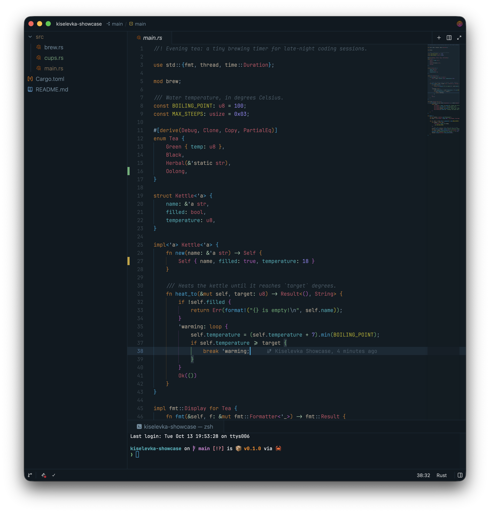

# kiselevka-zed

Kiselevka dark color theme for [the Zed code editor](https://zed.dev/)

The cozy dark theme for evening coding ;-)

Since v0.1.0 the theme is a bit more contrast: deeper backgrounds and brighter syntax colors.

Inspired by [Noctis](https://github.com/liviuschera/noctis#noctis-minimus), [Solarized](https://github.com/altercation/solarized) and others.

# License

[MIT license](./LICENSE)
