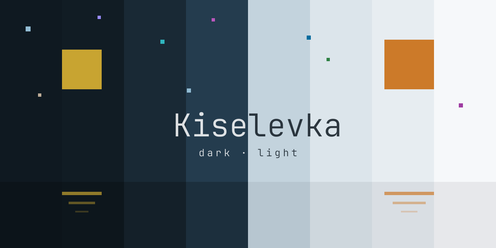
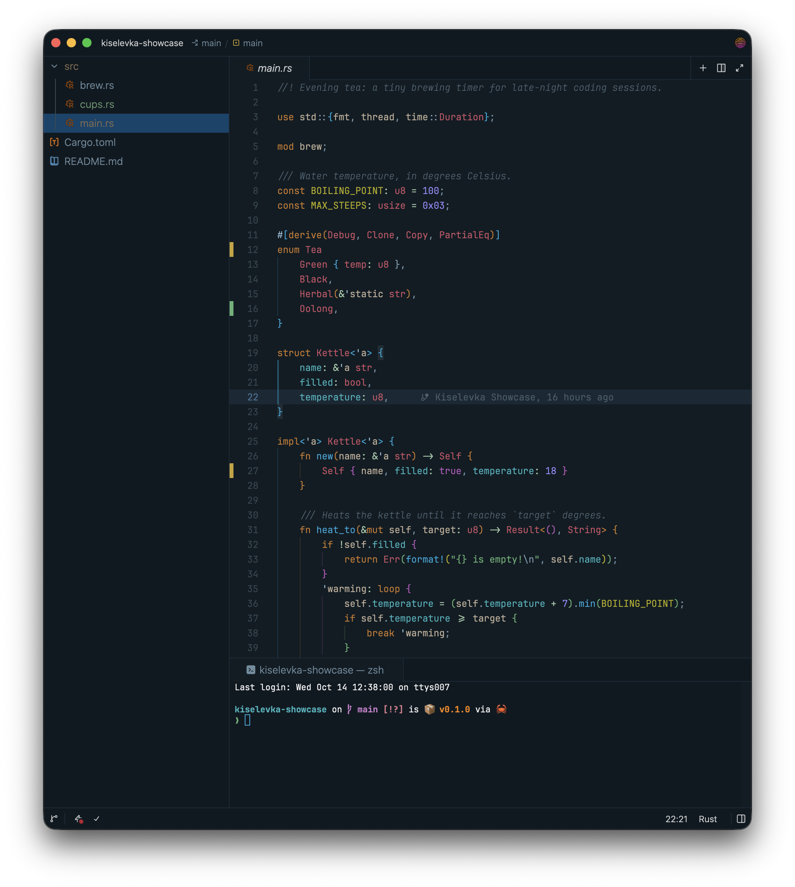
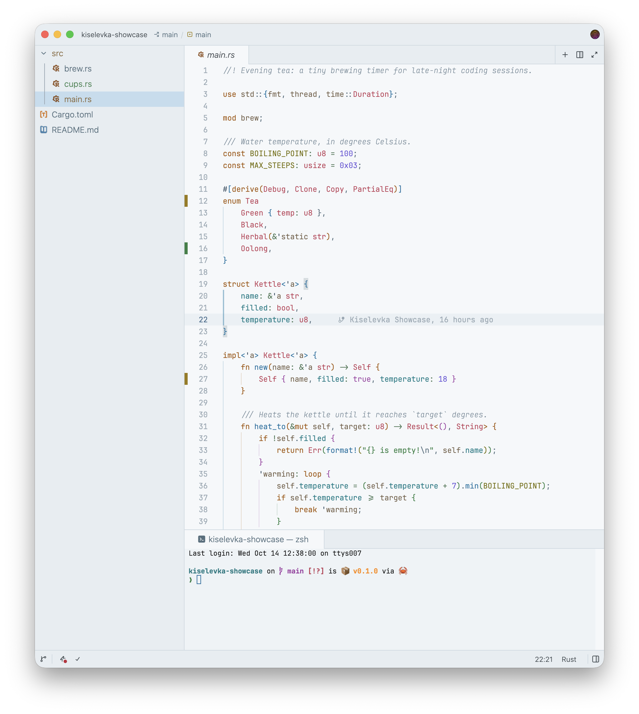

# Kiselevka

Cozy dark and light color themes for [the Zed code editor](https://zed.dev/).

- **Kiselevka Dark**: the calm night theme for evening coding ;-)
- **Kiselevka Light**: its morning counterpart, built from the same palette

Inspired by [Noctis](https://github.com/liviuschera/noctis#noctis-minimus), [Solarized](https://github.com/altercation/solarized) and others.

## Kiselevka Dark

## Kiselevka Light

## Installation

Open the extensions page in Zed (`zed: extensions`), search for **Kiselevka** and click Install.
Then pick **Kiselevka Dark** or **Kiselevka Light** in the theme selector (`theme selector: toggle`).

## License

[MIT license](./LICENSE)
